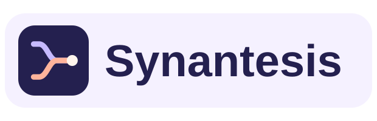

<p align="center">
  
</p>

# Synantesis

Synantesis is a self-hosted meeting scheduler based on [Tymeslot](https://github.com/Tymeslot/tymeslot). It provides public booking pages, calendar availability and sync, meeting reminders, and video integrations.

## Run from source

Clone [Synantesis](https://github.com/pyramidal-io/Synantesis) and check out the published commit you want to run. From that clean checkout:

```sh
cp .env.example .env
# Set SECRET_KEY_BASE and the other deployment settings in .env.
export SYNANTESIS_SOURCE_REVISION="$(git rev-parse HEAD)"
docker compose -f docker-compose.build.yml up -d --build
```

Use the [upstream Docker guide](README-Docker.md) for settings such as SMTP and TLS. Its published images are Tymeslot builds. Build Synantesis from this repository.

## Corresponding source

Release builds require the full Git commit of the source used to build them. Publish that commit in this public fork before deploying it. The application links to its commit tree from the booking, sign-in, and dashboard pages.

For a direct Docker build, pass `--build-arg SYNANTESIS_SOURCE_REVISION="$SYNANTESIS_SOURCE_REVISION"`. For a native release, export the same value before compiling and running `MIX_ENV=prod mix release tymeslot`. Railway Git builds can supply `RAILWAY_GIT_COMMIT_SHA`. Builds from a working tree with local changes need those changes committed and published before deployment.

## License and attribution

Synantesis is distributed under the [GNU Affero General Public License](LICENSE). See [COPYRIGHT](COPYRIGHT) and [CONTRIBUTORS.md](CONTRIBUTORS.md) for upstream notices and attribution. Tymeslot and its logo are trademarks of Diletta Luna OÜ. Synantesis uses its own name and logo. [Upstream trademark policy](TRADEMARK.md)
